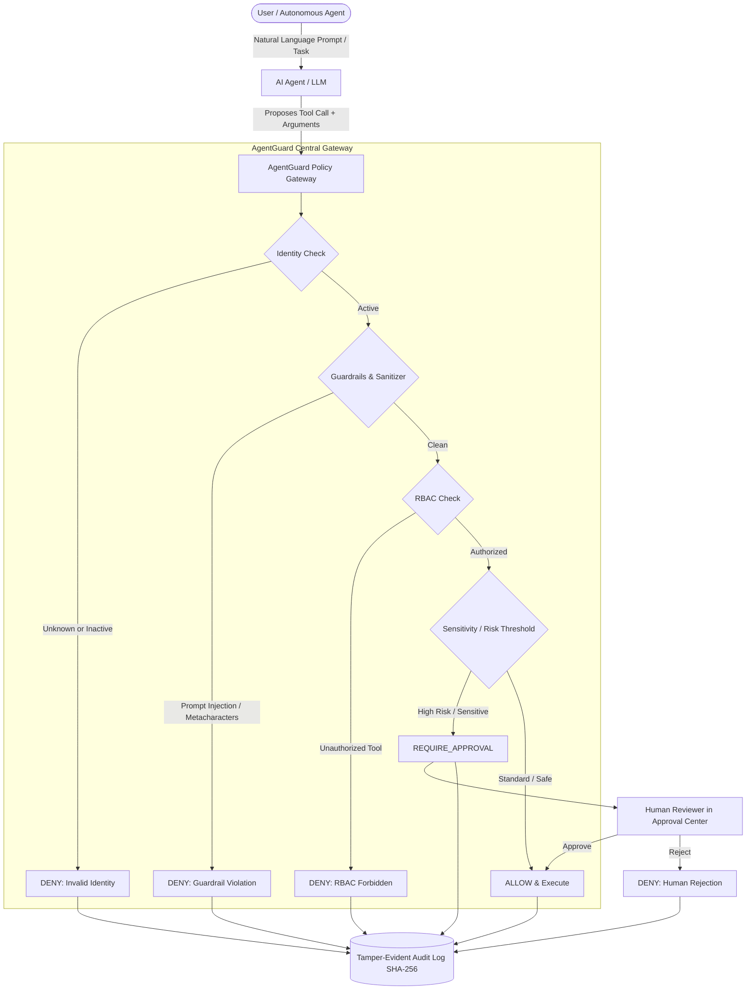

# AgentGuard – AI Agent Security & Governance Platform 🛡️

[](https://www.python.org/)
[](https://fastapi.tiangolo.com/)
[](https://streamlit.io/)
[](LICENSE)
[]()

> **AgentGuard** is an open-source, enterprise-grade AI security gateway and policy enforcement engine. It prevents autonomous LLM agents from executing unauthorized, dangerous, or unintended actions through runtime interception, role-based access control (RBAC), prompt injection guardrails, human-in-the-loop approvals, and tamper-evident audit logging.

---

## 🌟 Key Features

1. **AI Agent Management & Lifecycle**:
   - Register, inspect, activate, and deactivate AI agent identities.
   - Built-in profiles for Customer Support, Finance, and IT Admin agents.
   - Immediate rejection of unknown or deactivated agents.

2. **Default-Deny Security Model & RBAC**:
   - Least-privilege access control: agents cannot execute tools unless explicitly granted.
   - Role-based permissions mapped across roles and tools.

3. **Multi-Layered Security Guardrails**:
   - Interception of prompt injection, jailbreak keywords (`ignore previous instructions`, `override system`), shell metacharacters, and SQL injection signatures.
   - Automatic parameter schema, type, and range validation (e.g. positive amounts, valid port ranges).
   - Strict catalog verification to block unknown tools.

4. **Dynamic Policy Engine**:
   - Central backend evaluation returning three discrete outcomes:
     - `ALLOW` – Authorized, low/standard risk.
     - `DENY` – Blocked by identity check, RBAC, parameter rules, or guardrails.
     - `REQUIRE_APPROVAL` – Sensitive infrastructure, financial limits, or high-risk actions.

5. **Human-in-the-Loop Approval Center**:
   - High-value transactions or sensitive operations (e.g., service restart, firewall rules, high refunds) pause and queue for authorized human review.
   - **Self-Approval Prevention**: Agents are cryptographically and logically forbidden from approving their own requests.

6. **Tamper-Evident Append-Only Audit Trail**:
   - Every policy interception and human review is logged with timestamps, agent IDs, parameters, and decisions.
   - **SHA-256 Hash Chaining**: Every record is cryptographically linked to the previous entry, enabling verifiable mathematical proof that records were never altered or deleted.

7. **Autonomous Mock AI Agent Playground**:
   - 100% offline agent simulator that formulates actions without requiring paid external API keys.
   - Proves that no matter how an LLM plans or hallucinates an action, it can **never** bypass backend governance.

8. **Interactive Streamlit Dashboard**:
   - Comprehensive multi-page management console covering Overview KPIs, Agent Fleet, Permission Matrix, Policy Test Bench, Approval Queue, Audit Viewer, and Playground.

---

## 🏗️ System Architecture



---

## 💻 Technology Stack

| Layer | Technology | Purpose |
| :--- | :--- | :--- |
| **Backend Framework** | [FastAPI](https://fastapi.tiangolo.com/) | High-performance asynchronous REST API |
| **Database** | [SQLite](https://www.sqlite.org/) | Embedded ACID-compliant database |
| **ORM** | [SQLAlchemy 2.0](https://www.sqlalchemy.org/) | Type-safe database models and relationships |
| **Data Validation** | [Pydantic v2](https://docs.pydantic.dev/) | Strict request/response schemas & parsing |
| **Dashboard** | [Streamlit](https://streamlit.io/) | Interactive security operations console |
| **Testing** | [pytest](https://docs.pytest.org/) | 26 automated unit and security tests |
| **Version Control** | [Git & GitHub](https://github.com/) | Source code repository and tracking |

---

## 📁 Repository Structure

```
agentguard-ai-governance/
├── backend/
│   ├── __init__.py
│   ├── config.py              # Configuration settings and risk thresholds
│   ├── database.py            # SQLite engine, sessions, table initializers
│   ├── models.py              # SQLAlchemy models (Agent, Permission, ApprovalRequest, AuditLog)
│   ├── schemas.py             # Pydantic data contracts
│   ├── guardrails.py          # Prompt injection, tool catalogs, bounds validation
│   ├── policy_engine.py       # Core policy evaluation brain
│   ├── agent_service.py       # Agent lifecycle and registry
│   ├── approval_service.py    # Human approval workflow & queue
│   ├── audit_service.py       # SHA-256 cryptographic audit logger
│   ├── mock_agent.py          # Autonomous mock AI agent
│   ├── seed_data.py           # Preloaded enterprise sample agents and rules
│   └── main.py                # FastAPI REST application
├── frontend/
│   ├── __init__.py
│   ├── app.py                 # Streamlit Web Dashboard
│   └── components/
│       ├── __init__.py
│       └── api_client.py      # Resilient governance client
├── tests/
│   ├── __init__.py
│   ├── conftest.py            # Test fixtures and in-memory test database
│   ├── test_agent_management.py
│   ├── test_guardrails.py
│   ├── test_policy_engine.py
│   ├── test_approval_workflow.py
│   ├── test_audit_logs.py
│   └── test_mock_agent.py
├── scripts/
│   ├── run_backend.py         # Start FastAPI server
│   ├── run_dashboard.py       # Start Streamlit dashboard
│   └── seed_database.py       # Populate initial baseline data
├── docs/
│   └── screenshots/           # UI screenshots and visual assets
├── .gitignore
├── requirements.txt
└── README.md
```

---

## 🚀 Quick Start Guide

### 1. Prerequisites
- Python 3.11, 3.12, or 3.13
- Git

### 2. Clone the Repository
```bash
git clone https://github.com/gaganhg08/agentguard-ai-governance.git
cd agentguard-ai-governance
```

### 3. Create and Activate Virtual Environment
```bash
# Windows
python -m venv venv
.\venv\Scripts\activate

# Linux / macOS
python3 -m venv venv
source venv/bin/activate
```

### 4. Install Dependencies
```bash
pip install -r requirements.txt
```

### 5. Launch the Platform

#### Option A: Run the Streamlit Dashboard (Full interactive experience)
```bash
python scripts/run_dashboard.py
```
*Or directly:*
```bash
streamlit run frontend/app.py
```
Open your browser at `http://localhost:8501`.

#### Option B: Run the FastAPI REST Server
```bash
python scripts/run_backend.py
```
Open interactive Swagger API Documentation at:
- **API Docs (Swagger UI)**: `http://127.0.0.1:8000/docs`
- **ReDoc UI**: `http://127.0.0.1:8000/redoc`

---

## 🧪 Running the Security Test Suite

AgentGuard includes 26 rigorous unit and integration tests verifying authorization, edge cases, injection attacks, and cryptographic integrity.

Run the test suite with:
```bash
pytest tests/ -v
```

### Test Coverage Highlights:
- ✅ **Authorized Actions**: Normal operations correctly evaluated as `ALLOW`.
- ✅ **Unauthorized Actions**: Cross-role access denied via RBAC (`DENY`).
- ✅ **Inactive Agent Guard**: Decommissioned agents immediately blocked (`DENY`).
- ✅ **Unknown Agent Guard**: Unregistered identities rejected (`DENY`).
- ✅ **Unregistered Tool Guard**: Arbitrary/unrecognized tool executions prevented (`DENY`).
- ✅ **Prompt Injection Guard**: Adversarial prompts and payload attacks blocked (`DENY`).
- ✅ **Human Approvals**: High-risk actions paused (`REQUIRE_APPROVAL`).
- ✅ **Self-Approval Prevention**: Agents cannot review or approve their own requests.
- ✅ **Tamper-Evident Auditing**: SHA-256 hash chains verify integrity and detect tampering.

---

## 🧭 Dashboard Walkthrough

1. **📊 Overview**: Live telemetry, total interceptions, security blocks, active fleet breakdown, and decision charts.
2. **🤖 Agent Management**: Inspect registered agent cards, toggle active/deactive status, or register new agent identities.
3. **🛡️ Permission Matrix**: Role-to-tool permission grid and catalog of registered capabilities with baseline risk tiers.
4. **⚖️ Policy Evaluation**: Interactive workbench to simulate tool calls and inspect decisions (`ALLOW`, `DENY`, `REQUIRE_APPROVAL`).
5. **✋ Approval Center**: Review paused sensitive actions, view requested arguments, and click to Approve or Reject with reviewer notes.
6. **📜 Audit Logs**: Real-time audit trail with a **Verify Hash Chain Integrity** button that cryptographically checks every block.
7. **🧪 AI Agent Playground**: Interactive sandbox where you give natural language instructions to an agent and watch AgentGuard intercept the planned tool calls in real time.

---

## 🔒 Security Principles

- **Zero-Trust for AI**: Treat all LLM outputs as untrusted user input. Never execute raw tool calls directly without backend validation.
- **Fail-Safe Defaults**: Any action, tool, or parameter not explicitly allowed is denied by default.
- **Separation of Duties**: AI agents propose; the backend governance engine verifies; humans authorize high-consequence operations.
- **Non-Repudiation**: Append-only audit logs with SHA-256 hash chaining guarantee tamper evidence.

---

## 🔮 Limitations & Future Enhancements

- **Fine-Grained Semantic Guardrails**: Incorporating embeddings-based semantic similarity to detect sophisticated prompt injection variants.
- **Multi-Tenant Organizations**: Adding workspace-level tenancy and multi-role reviewer groups.
- **Distributed Database Adapters**: PostgreSQL adapter with row-level security (RLS) for multi-node deployments.
- **OpenTelemetry Export**: Native OTel instrumentation for enterprise SIEM ingestion (Splunk, Datadog).

---

## 📄 License

This project is licensed under the [MIT License](LICENSE).
