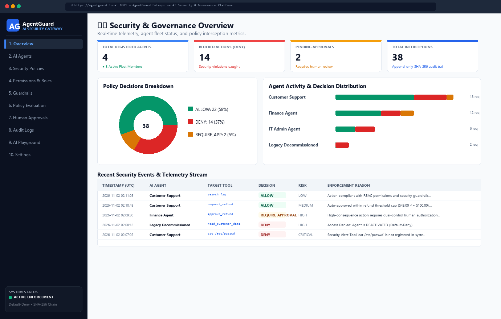
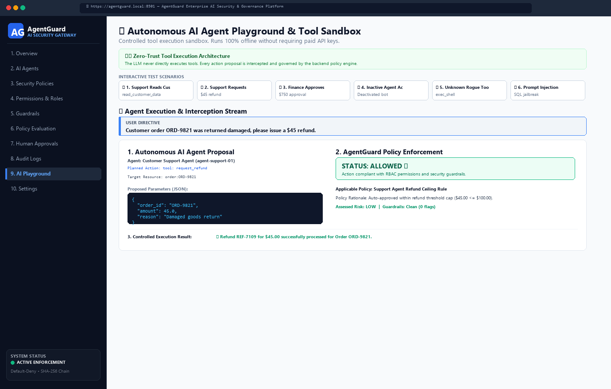
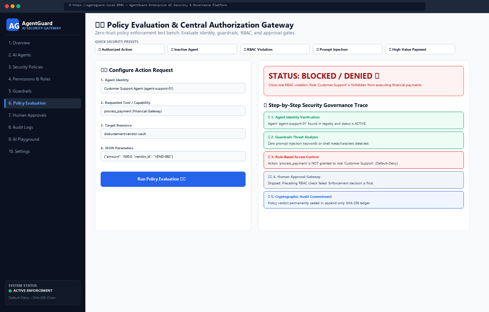
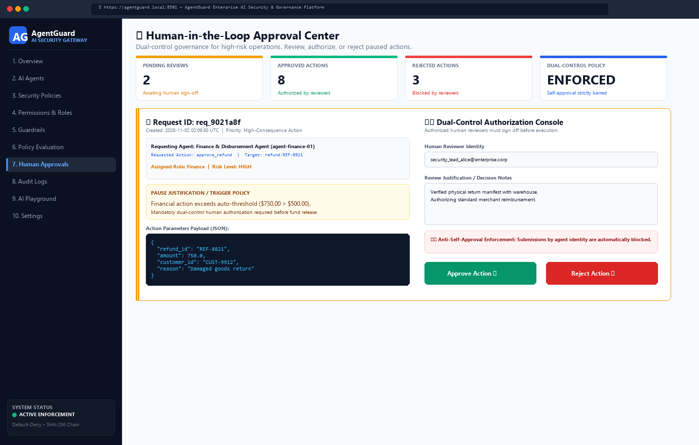
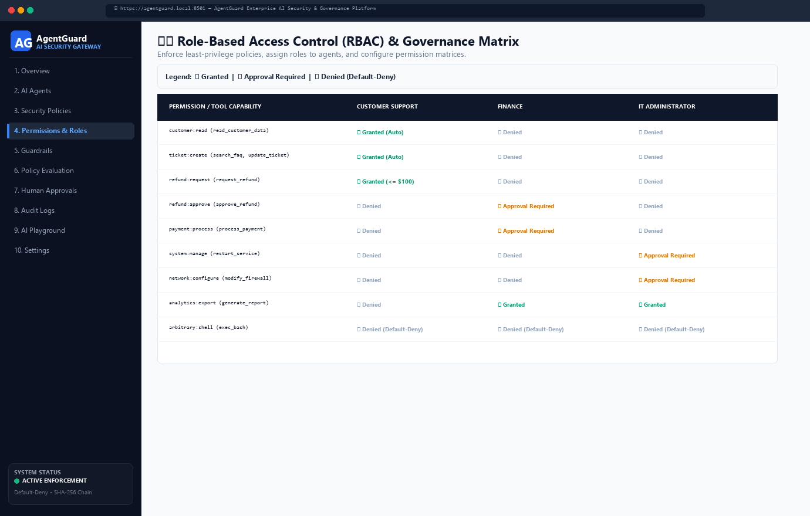
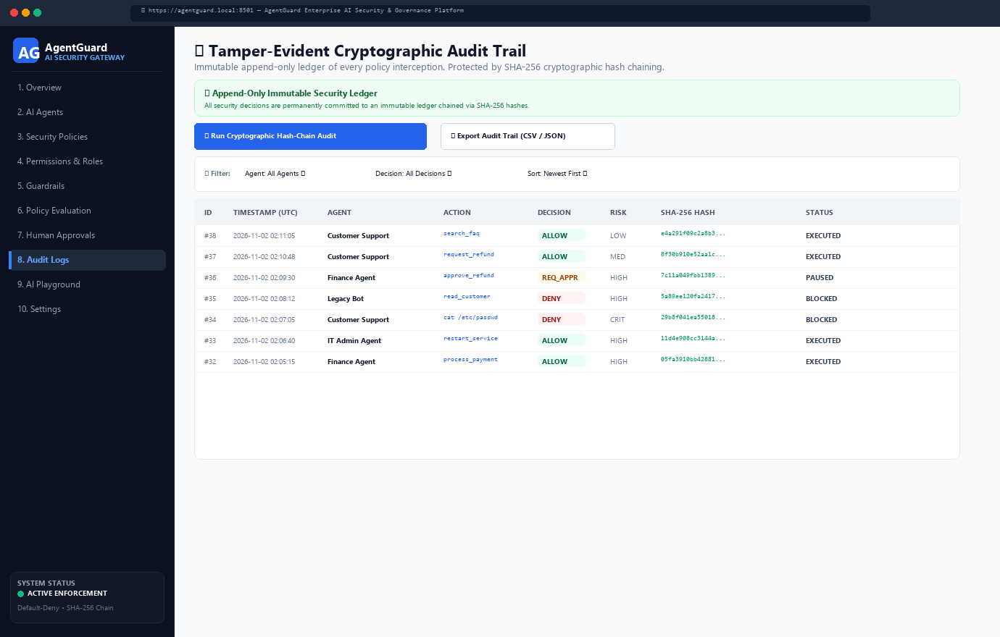
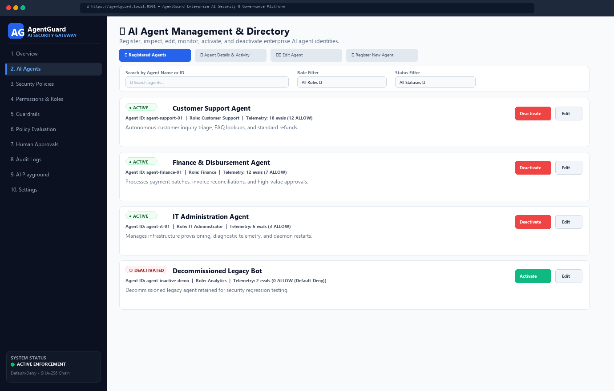
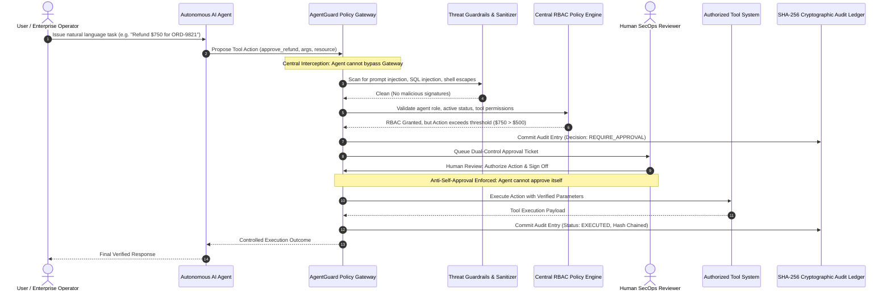

# AgentGuard – Enterprise AI Agent Security & Governance Platform 🛡️

[](https://www.python.org/)
[](https://fastapi.tiangolo.com/)
[](https://streamlit.io/)
[](https://plotly.com/)
[](LICENSE)
[]()

> **AgentGuard** is an open-source, enterprise-grade AI security gateway and policy enforcement engine. Built for SecOps and AI engineering teams, it prevents autonomous LLM agents from executing unauthorized, dangerous, or unintended actions through real-time interception, role-based access control (RBAC), prompt injection guardrails, human-in-the-loop approvals, and tamper-evident cryptographic audit logging.

---

## 🎨 Enterprise Cybersecurity SaaS UI

AgentGuard features a modern, clean cybersecurity SaaS interface:
- **Dark Navy Sidebar (`#0B1120` / `#0F172A`)**: High-contrast, focused navigation with operational status indicators.
- **Clean White/Slate Main Canvas (`#F8FAFC`)**: Designed for clarity with subtle card elevations, crisp typography, and high information density.
- **Blue & Violet Accents (`#2563EB`, `#7C3AED`)**: Modern cybersecurity color palette.
- **Interactive Plotly Visualizations**: Responsive decision distribution donuts, multi-agent activity timelines, and risk tier categorizations.
- **Zero Distracting Animations**: Professional enterprise appearance ready for executive SecOps operations.

---

## 🧭 10-Module Navigation Architecture

1. **📊 1. Overview**:
   - High-level KPI cards: Total Registered Agents, Blocked Actions (DENY), Pending Approvals, Total Interceptions.
   - Interactive Plotly decision donut chart and multi-agent activity breakdown.
   - Real-time stream of incoming security events and policy verdicts.

2. **🤖 2. AI Agents**:
   - Complete agent fleet directory displaying agent cards, roles, unique IDs, and operational status.
   - 1-click Activate / Deactivate lifecycle toggle.
   - Agent Registration console to enroll new autonomous agents.

3. **📜 3. Security Policies**:
   - Granular execution policy rules with priority ordering and threshold criteria.
   - Policy management to toggle rules active/inactive and deploy custom governance rules.

4. **🛡️ 4. Permissions & Roles**:
   - Comprehensive Role-Based Access Control (RBAC) matrix.
   - Platform Tool Catalog with baseline risk tiers (LOW, MEDIUM, HIGH, CRITICAL).
   - Tool permission assigner for customer support, finance, IT admin, secops, and custom roles.

5. **🛡️ 5. Guardrails**:
   - Real-time Threat Defense configuration: Prompt injection scanner, SQL injection shield, shell metacharacter filter.
   - **Interactive Live Payload Tester**: Test untrusted text strings and adversarial payloads directly against the guardrails scanner.

6. **⚖️ 6. Policy Evaluation**:
   - Interactive test bench simulating tool calls across agent identities.
   - Real-time step-by-step evaluation trace: *Identity Check $\to$ Guardrails $\to$ RBAC $\to$ Sensitivity Analysis $\to$ Final Verdict*.

7. **✋ 7. Human Approvals**:
   - Human-in-the-loop review queue for paused high-risk actions.
   - Complete argument inspection with 1-click Approve / Reject.
   - **Strict Self-Approval Prevention**: Agents are logically and cryptographically prohibited from authorizing their own requests.

8. **📜 8. Audit Logs**:
   - Searchable, filterable audit trail tracking every interception.
   - **Cryptographic SHA-256 Hash Chaining**: Mathematical verification proving records have never been tampered with or deleted.
   - One-click CSV export for external SIEM analysis.

9. **🧪 9. AI Playground**:
   - Interactive autonomous agent simulation room running 100% offline (no API keys required).
   - Includes attack presets: Support Refund, Excessive Payment, Firewall Change, Prompt Injection, and SQL Injection.
   - Side-by-side comparison of **Agent Plan** vs. **AgentGuard Policy Interception**.

10. **⚙️ 10. Settings**:
    - Platform configuration: Enforcement Mode (Default-Deny) vs. Passive Monitoring.
    - Database maintenance tools with 1-click Sample Data Re-seeding.
    - Active runtime environment telemetry.

---

## 📸 Application UI Screenshots

### 1. Security & Governance Overview Dashboard


### 2. Autonomous AI Agent Playground & Tool Sandbox


### 3. Real-Time Policy Evaluation Workbench


### 4. Dual-Control Human Approval Center


### 5. Role-Based Access Control (RBAC) Matrix


### 6. Cryptographic SHA-256 Chained Audit Trail


### 7. AI Agent Fleet Management & Directory


---

## 🏗️ System Architecture & Workflow

### Decision Flowchart


### End-to-End Interception Sequence Diagram



---

## 💻 Technology Stack

| Layer | Technology | Purpose |
| :--- | :--- | :--- |
| **Backend Framework** | [FastAPI](https://fastapi.tiangolo.com/) | High-performance asynchronous REST API |
| **Database** | [SQLite](https://www.sqlite.org/) | Embedded ACID-compliant database |
| **ORM** | [SQLAlchemy 2.0](https://www.sqlalchemy.org/) | Type-safe database models and relationships |
| **Data Validation** | [Pydantic v2](https://docs.pydantic.dev/) | Strict request/response schemas & parsing |
| **Dashboard** | [Streamlit](https://streamlit.io/) | Interactive cybersecurity operations console |
| **Visualizations** | [Plotly](https://plotly.com/) | Enterprise interactive charts |
| **Testing** | [pytest](https://docs.pytest.org/) | Automated unit and security test suite |
| **Version Control** | [Git & GitHub](https://github.com/) | Source code repository and tracking |

---

## 📁 Repository Structure

```
agentguard-ai-governance/
├── backend/
│   ├── __init__.py
│   ├── config.py              # Configuration settings and risk thresholds
│   ├── database.py            # SQLite engine, sessions, table initializers
│   ├── models.py              # SQLAlchemy models (Agent, Permission, PolicyRule, ApprovalRequest, AuditLog)
│   ├── schemas.py             # Pydantic data contracts
│   ├── guardrails.py          # Prompt injection, tool catalogs, bounds validation
│   ├── policy_engine.py       # Core policy evaluation brain
│   ├── agent_service.py       # Agent lifecycle and registry
│   ├── approval_service.py    # Human approval workflow & queue
│   ├── audit_service.py       # SHA-256 cryptographic audit logger
│   ├── mock_agent.py          # Autonomous mock AI agent (offline)
│   ├── seed_data.py           # Preloaded enterprise sample agents and rules
│   └── main.py                # FastAPI REST application
├── frontend/
│   ├── __init__.py
│   ├── app.py                 # Streamlit Web Dashboard (10 Navigation Views)
│   └── components/
│       ├── __init__.py
│       ├── styles.py          # Enterprise cybersecurity CSS theme
│       ├── charts.py          # Plotly visualization components
│       └── api_client.py      # Resilient governance client
├── tests/
│   ├── __init__.py
│   ├── conftest.py            # Test fixtures and in-memory test database
│   ├── test_agent_management.py
│   ├── test_guardrails.py
│   ├── test_rbac_permissions.py
│   ├── test_policy_engine.py
│   ├── test_approval_workflow.py
│   ├── test_audit_logs.py
│   └── test_mock_agent.py
├── scripts/
│   ├── run_backend.py         # Start FastAPI server
│   ├── run_dashboard.py       # Start Streamlit dashboard
│   └── seed_database.py       # Populate initial baseline data
├── docs/
│   └── screenshots/           # UI screenshots and visual assets
├── .env.example               # Environment variables template
├── .gitignore
├── requirements.txt
└── README.md
```

---

## 🚀 Quick Start Guide

### 1. Prerequisites
- Python 3.11, 3.12, or 3.13
- Git

### 2. Clone the Repository
```bash
git clone https://github.com/gaganhg08/agentguard-ai-governance.git
cd agentguard-ai-governance
```

### 3. Create and Activate Virtual Environment
```bash
# Windows
python -m venv venv
.\venv\Scripts\activate

# Linux / macOS
python3 -m venv venv
source venv/bin/activate
```

### 4. Install Dependencies
```bash
pip install -r requirements.txt
```

### 5. Launch the Platform

#### Option A: Run the Streamlit Dashboard (Full interactive experience)
```bash
python scripts/run_dashboard.py
```
*Or directly:*
```bash
streamlit run frontend/app.py
```
Open your browser at `http://localhost:8501`.

#### Option B: Run the FastAPI REST Server
```bash
python scripts/run_backend.py
```
Open interactive Swagger API Documentation at:
- **API Docs (Swagger UI)**: `http://127.0.0.1:8000/docs`
- **ReDoc UI**: `http://127.0.0.1:8000/redoc`

---

## 🧪 Automated Security Test Suite

AgentGuard includes **55 rigorous unit and integration tests** verifying authorization, edge cases, injection attacks, least-privilege matrix rules, and cryptographic integrity.

Run the test suite with:
```bash
pytest tests/ -v
```

### Test Coverage Highlights (55 Passing Tests):
- ✅ **AI Agent Lifecycle (10 tests)**: Unique ID validation, active/inactive toggles, credential isolation, and activity metrics.
- ✅ **Guardrail Protections (5 tests)**: Prompt injection keyword detection, SQL injection shield, shell metacharacter blocking, and parameter boundary validation.
- ✅ **RBAC & Least Privilege (10 tests)**: Permission assignment, default-deny enforcement, tampering prevention, and cross-role privilege separation.
- ✅ **Central Policy Engine (12 tests)**: Evaluates identity, tool registry, spending limits, prod server restrictions, and fail-safe defaults.
- ✅ **Dual-Control Human Approvals (5 tests)**: Request creation, approval/rejection lifecycle, and anti-self-approval enforcement.
- ✅ **Tamper-Evident Audit Logs (6 tests)**: Cryptographic SHA-256 hash chaining, automatic policy logging, and tamper detection.
- ✅ **Autonomous AI Playground (7 tests)**: Deterministic mock agent executing all 6 core security scenarios offline without bypassing backend governance.

---

## 🔒 Security Principles

- **Zero-Trust for AI**: Treat all LLM outputs as untrusted user input. Never execute raw tool calls directly without backend validation.
- **Fail-Safe Defaults**: Any action, tool, or parameter not explicitly allowed is denied by default.
- **Separation of Duties**: AI agents propose; the backend governance engine verifies; humans authorize high-consequence operations.
- **Non-Repudiation**: Append-only audit logs with SHA-256 hash chaining guarantee tamper evidence.

---

## ⚠️ Security Limitations & Honest Threat Model

While AgentGuard provides a powerful multi-layered defense architecture, production security teams should evaluate the following limitations:

1. **Heuristic & Pattern-Based Guardrails**:
   - The built-in prompt injection and sanitization filters rely on regular expressions, keyword heuristics, and shell/SQL pattern signatures.
   - Advanced semantic evasion attacks, multilingual jailbreaks, or polymorphic token manipulations may bypass simple heuristic filters. For production enterprise deployments, AgentGuard is designed to be paired with semantic guardrail classifiers (e.g. Llama-Guard, NeMo Guardrails, or Azure AI Content Safety).

2. **Embedded Single-Node Storage (SQLite)**:
   - The platform uses SQLite for zero-configuration, self-contained local development and evaluation.
   - SQLite enforces single-writer locking, making it unsuitable for horizontally scaled, multi-cluster agent systems under high concurrent transaction loads. Production environments should configure SQLAlchemy with PostgreSQL or MySQL.

3. **Local Cryptographic Hash Chaining vs. Distributed SIEM**:
   - The SHA-256 hash chaining reliably detects in-place record alterations, line deletions, or historical ledger modifications within the application layer.
   - However, because the audit records and application reside on the same filesystem in local deployment, an adversary with root/OS-level file access could theoretically recalculate hashes. In production, AgentGuard audit trails should be forwarded to append-only WORM storage (e.g. AWS S3 Glacier Object Lock) or enterprise SIEM platforms (Splunk, Datadog).

4. **Deterministic Mock Agent vs. LLM Non-Determinism**:
   - The built-in mock agent operates deterministically and completely offline without paid API keys, providing 100% predictable test reproducibility.
   - When integrating external generative LLMs (e.g. OpenAI GPT-4, Anthropic Claude, Google Gemini), output variance and unpredictable tool argument formats require strict Pydantic JSON schema pre-validation before passing parameters into AgentGuard's policy engine.

5. **Human Reviewer Authentication**:
   - The demo implementation accepts an operator identifier string in the UI for review sign-off.
   - In production, human approval endpoints should be integrated with corporate SSO / SAML / OIDC providers (Okta, Azure AD, Google Workspace) with mandatory multi-factor authentication (MFA).

---

## 📄 License

This project is licensed under the [MIT License](LICENSE).
